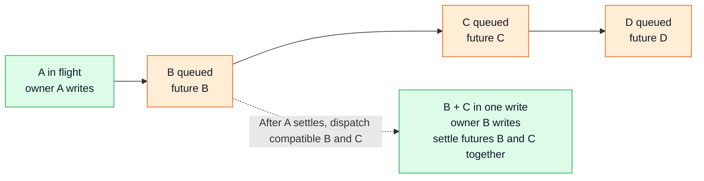

# Workflow operation pipeline interface proposal

Allow the next operation on a workflow to mutate state while an earlier operation
is waiting for persistence. Each operation releases the workflow lock before
waiting for its persistence dependency. Queued submissions remain separate until
dispatch, when compatible neighbors can share one physical write. Each submission
keeps its own completion future; a dispatched batch settles its members together.

This is the interface review checkpoint. The Go declarations below are proposed
contracts, not compiled declarations or changes to runtime behavior. The first
runtime scope is explicitly migrated active updates to one existing run that
have no deferred handler actions. Workflow-task completion, creation,
update-with-new, reset, replication, and maintenance operations retain
committed-state access and synchronous persistence until explicitly integrated.

## Commit groups and dependencies



The workflow context owns a FIFO of separate submissions. At most one commit
group is in flight. When the head submission can dispatch, its request selects
a bounded contiguous compatible prefix and merges it into that group's write.
Selection, merging, and the dispatch claim are serialized with cancellation
under the pipeline mutex. There is no batching delay: use only submissions
already ready at that point. The group is frozen once claimed; new submissions
remain queued for a later write.

The first FIFO implementation dispatches one submission per write; combining
B+C is introduced in the coalescing stage. An operation can record several
submissions while holding the workflow lock. Operation ownership and persistence
batching are separate concerns. A batch's first submission determines its
executing request.

Every member's completion succeeds after the group's write succeeds through the
existing transaction path and committed accounting is settled. The owner settles
all members before the next queued submission can dispatch. Waiting requests
derive their predecessor from the queue under the pipeline mutex and wait on
its completion; no predecessor pointer or separate dispatch future is stored.

| Operation | Dependency |
| --- | --- |
| A | A's completion future |
| B and C | Their separate completion futures, settled with the same result if dispatched together after A |
| Read or no-op after B | B's completion future captured while holding the workflow lock |

A read after B retains B's future if C is later queued. If B and C dispatch
together, the read waits for that batch and fails if the batch fails. If C
cancels before dispatch, B and the read remain eligible to succeed. Batch limits
bound coupling once a batch has been claimed.

## Shared interfaces

Proposed changes in `service/history/interfaces`:

```go
// Excerpt of WorkflowContext.
type WorkflowContext interface {
	Lock(ctx context.Context, priority locks.Priority) error
	LockSpeculative(ctx context.Context, priority locks.Priority) error
	Unlock() error
	PersistenceFuture() future.Future[struct{}]
}

type ReleaseWorkflowContextFunc func(
	operationErr error,
) error
```

- `Lock` provides committed-state access. It registers an admission barrier
  before waiting, drains already admitted writes outside the physical lock,
  and reacquires and revalidates before returning. Later speculative callers
  cannot extend the prefix it is draining.
- `LockSpeculative` admits migrated operations after checking that the current
  pipeline and loaded state are valid and no earlier committed-access barrier
  blocks admission. It starts an operation with `pipelined` enabled. Such
  operations can read and extend speculative state, and eligible persistence
  calls enqueue their prepared writes.
- `PersistenceFuture` captures the current dependency under the workflow lock.
  Under the pipeline mutex, return a completed failure if `err` is set. Otherwise
  use the last pending submission's future, then the last in-flight member's
  future, then an already successful future. This prevents removing a failed
  suffix from exposing an earlier successful future for a read of invalid
  speculative state.
- `Unlock` moves the current `operation` to local ownership before releasing
  the underlying semaphore. This captures its ordered submissions and state
  dependency together.
  The operation also retains its original request context, so completion needs
  no context argument and never reads a newer acquisition's context. Temporary
  lock-acquisition timeout contexts must not cancel a valid handler's wait.
  It walks the submissions in order, claiming dispatch if eligible or waiting
  if an earlier request has selected its submission into a batch. Success
  requires all its submissions to settle successfully. Submitted writes use
  their own futures, preserving earlier valid results when a later submission
  is canceled. A read or no-op waits for its captured state dependency.
- The cache release function coordinates cleanup with outstanding writes, calls
  `Unlock`, and releases the caller's cache pin. A persistence error takes
  precedence over a result derived from failed speculative state. Otherwise it
  returns `operationErr`. RPC responses and task acknowledgments must use this result.

`WorkflowLease` uses its existing `GetReleaseFn` method. Completion reuses the
existing future primitive. Deferred release calls must propagate the returned
error:

```go
defer func() {
	retErr = release(ctx, retErr)
}()
```

Only internal coordination uses raw semaphore release: a group owner after
publishing completion, temporary releases while acquiring committed-state
access, and exceptional cleanup. These paths must not call the public `Unlock`
and wait on a future the current code is responsible for completing.

The pipeline owns a cache pin until outstanding writes and publication settle,
even if a caller cancels its wait and releases its own pin. Queued writes can be
canceled as described below. Once dispatched, the owner uses a bounded write
context tied to shard lifetime, independent of the submitting caller's deadline.

Handler errors and cache invalidation remain separate decisions. Abandoning dirty
state marks the pipeline invalid and follows the recovery rule below.
A read-only business error must not clear other operations' queued state.
Responses must own their data before releasing the lock. After all of an
operation's submissions are aborted or published, old callers only observe
their results and release their cache pin. They must not clear or otherwise
modify a newly loaded context.

## Committed access and prerequisite writes

A committed acquisition registers its admission barrier before waiting for
queued persistence. An already admitted speculative holder may finish and
submit its writes; later speculative acquisitions wait before observing or
mutating state. After that holder releases the physical lock, the committed
caller captures the complete accepted prefix, releases the lock while it
drains, then reacquires and revalidates. The barrier remains in place throughout
this sequence, so continuous speculative arrivals cannot keep extending the wait.

Committed waiters retain their admission order. Remove a waiter's registration
when it acquires committed access or cancels; cancellation must not remove
another waiter's barrier or reopen speculative admission ahead of it. Once a
committed caller has acquired access, the physical workflow lock protects its
handler. Internal group publication bypasses the admission gate so draining
cannot deadlock. Barrier bookkeeping uses the pipeline mutex, which must be
released before acquiring the physical workflow lock or waiting.

The barrier provides scheduling fairness. It does not set `err`: queued state
can remain valid while admission is closed.

Initial pipelining does not defer prerequisite persistence inside
`LoadMutableState`. If loading requires a failover flush, route the acquisition
through committed access and keep the flush and handler synchronous. If
`StartTransaction` has already changed tentative state when this is discovered,
close admission, let the previously accepted prefix settle outside the lock,
and discard and reload that tentative state under the lock before restarting
preparation. Do not persist it synchronously over outstanding queued writes.
An interrupted transition must leave invalid tentative state unavailable until
recovery completes.

Recording multiple submissions prevents ownership from being overwritten; it
does not establish that every existing synchronous call can be deferred. Each
additional path needs an audit before it may enqueue prerequisite writes.

## Workflow task completion

Workflow-task completion keeps its existing sequence:

```text
Acquire committed-state lock
    -> Persist synchronously
    -> effects.Apply(ctx) while holding the workflow lock
    -> Unlock
```

Committed-state acquisition retains its admission barrier while draining earlier
queued writes outside the lock and revalidating after reacquisition. The handler
then holds the workflow lock through its own persistence and after-persistence
actions, so later speculative operations cannot interleave with that sequence.

Pipelining is selected per operation for explicitly migrated callers. The
context records `operation.pipelined` under the workflow lock. Shared
persistence methods enqueue only eligible writes when that flag is enabled;
committed operations retain their synchronous write path. Changing a shared
method to always enqueue would break the workflow-task handler's existing ordering.

Other handlers with deferred actions, including Update registry aborts, also
retain their committed synchronous path initially. Migrating workflow-task
completion later requires coordinating its existing after-persistence block
under the workflow lock and preserving provisional Update registry transitions.
That integration is a separate stage.

## Workflow context structures

Proposed private types in `service/history/workflow/persistence_pipeline.go`:

```go
type submission struct {
	ctx             context.Context
	failoverVersion int64
	request         *persistence.UpdateWorkflowExecutionRequest
	completion      *future.FutureImpl[struct{}]
}

type operation struct {
	pipelined   bool
	submissions []*submission
	dependency  future.Future[struct{}]
	ctx         context.Context
}

type persistencePipeline struct {
	mu                       sync.Mutex
	err                      error
	inFlight                 []*submission
	pending                  []*submission
	committedDBRecordVersion int64
}

func (p *persistencePipeline) submit(
	ctx context.Context,
	failoverVersion int64,
	request *persistence.UpdateWorkflowExecutionRequest,
) (*submission, error)

func composeRequests(
	current, next *persistence.UpdateWorkflowExecutionRequest,
) (*persistence.UpdateWorkflowExecutionRequest, error)
```

`ContextImpl` owns one pipeline and records the current operation while holding
the workflow lock. A prepared request owns its mutable data, including protobuf
values, history events, and task objects. Preparation must
clone or transfer ownership before later operations can mutate the workflow.
The writer must not read a later operation's mutable state. Dispatch finalizes
only explicitly identified persistence-generated metadata from the committed
baseline described below. The existing `Transaction` and shard write path
execute the request and retain their task allocation, ownership checks, and
persistence error handling.

Each `submission` retains its prepared write and its own completion future while
queued. Its request context is used for cancellation checks before dispatch;
dispatched persistence uses the bounded shard-lifetime context. The context
records every submission in the current `operation` and moves the operation
to local ownership before releasing the workflow lock. A second write appends
to the list instead of replacing the first write's
responsibility. `pipelined` selects deferred persistence and permits access to
valid speculative state; it does not claim that uncommitted state always exists.
`dependency` captures the state observed by the operation so reads, no-ops, and
state-derived errors can wait for durability. Admission waiter bookkeeping and
committed metadata are coordinated by the same pipeline mutex; those fields
are outside these core write-tracking sketches.

`inFlight` contains the claimed submissions in FIFO order. Its first submission
determines the executing request. That request keeps the merged persistence
request and its result locally through final publication, so a separate stored
batch wrapper is unnecessary. Other members wait for their own completion
futures. No pending submission changes its future when batched. Workflow identity
is validated from the owned requests rather than copied into another wrapper.

`Unlock` walks submissions in order, executing a group if it wins the head's
dispatch claim or waiting if another request has already claimed that submission.
If several submissions from one operation share a dispatched group, the group
is executed once. It must not return early and strand another accepted submission.
A failure aborts dependent submissions; cancellation follows the rules below.
The initial eligible handlers produce a final queued write, while prerequisite
flushes retain the synchronous route described above.

`completion` reports a submission's final result. Add a `Done() <-chan struct{}`
method to the existing concrete `future.FutureImpl` so requests can select on
their own completion, a predecessor's completion, and request cancellation
without helper goroutines. The public `future.Future` interface need not change.

Under `mu`, a queued submission derives its predecessor from the preceding
pending entry, or from the last in-flight entry if it is the pending head. With
no predecessor and no active write, the head may attempt dispatch immediately.
A submission already selected by another writer waits for its own completion.
Every wakeup rechecks completion and queue membership under `mu`; predecessor
completion alone does not grant execution ownership. Waiting on its own
completion as well ensures explicit invalidation wakes a request even while
its predecessor is still writing.

`failoverVersion` captures `MutableState.GetCurrentVersion()` during preparation.
It preserves the existing transaction argument for active/passive completion
metrics and lets the composer reject merges across failover versions. It does
not replace namespace or shard ownership checks, and it is separate from the
DB record version used for conditional persistence writes.

`committedDBRecordVersion` records the last successfully persisted physical
record revision. Initialize it when loading state, advance it after successful
writes, and refresh it after synchronous persistence or recovery. Queued logical
operations do not each reserve a database revision.

The transaction adapter derives `isWorkflow` from the request's archetype:
`request.ArchetypeID == chasm.WorkflowArchetypeID`. It is always true for the
initial Workflow-only scope, so submissions do not store a separate flag.

The initial pipeline owns persistence requests and their completion futures.
Handler effect buffers stay with their existing synchronous handlers. Coalescing
limits the number and bytes of submissions selected at dispatch. The logical
write count is `len(inFlight)`, including writes with no history events;
it does not require a separately stored operation count.

## Request owned FIFO execution

Persistence runs on the owning request's goroutine inside `Unlock`, after the
physical workflow lock has been released:

```text
A: release lock -> write A -> publish A -> return
B: release lock -> wait for A completion -> write B+C -> publish -> return
C: release lock -> selected into B's batch -> wait for C completion -> return
```

1. Under the workflow lock and pipeline mutex, enqueue each prepared write as a
   separate submission and append it to this operation. Do not merge here.
2. Move the operation to local ownership and release the workflow lock. Walk its
   submissions in order. Under `mu`, check each submission's completion and
   membership, and derive its predecessor if it is still queued. Release `mu`
   before waiting on the predecessor, its own completion, or request cancellation.
   A member selected by another writer waits only for its own completion or
   cancellation. On wakeup, recheck under `mu`; use its own final result rather
   than returning another request's cancellation error.
3. When the submission is the pending head and no write is active, check candidate
   request contexts under `mu`, handle any canceled submission and its suffix,
   select a contiguous compatible prefix within count and byte limits, and
   compose its write. Set the existing request's `DBRecordVersion` to the
   committed physical revision plus one. Atomically remove that prefix and store
   its members in `inFlight`. This claim is the dispatch point shared with cancellation. Only
   the head's request writes; selected members need no separate notification.
4. Materialize the claimed batch's persistence-generated metadata from the
   committed prefix, then persist its frozen workflow data outside both locks.
   Once dispatched, the owner continues through publication even if its request
   is canceled afterward.
5. Acquire the workflow lock internally, then `mu`, to settle committed
   metadata feedback and all member completions. Clear `inFlight` and resolve
   completions, which wake dependent requests. Finish this group's publication
   before the next request can claim dispatch. No bookkeeping for this group
   may mutate workflow state after publication.
6. Continue through any remaining submissions belonging to this operation,
   then return its result. The owner does not drain unrelated later groups
   before returning, and the next group does not wait for the previous RPC to
   return. Previously published groups are never published again.

`mu` protects dispatch claims, cancellation, queue membership, and predecessor
selection. Admission and publication acquire the workflow lock before `mu`. Never hold
`mu` while waiting for the workflow lock, persistence, or a future. Publication
uses internal locking and raw release instead of the public committed-state
`Lock` and waiting `Unlock`.

Bound outstanding submissions before admitting more speculative mutations. The
first version claims one submission per group. Coalescing adds bounded prefix
selection and merging at dispatch; it never merges pending entries at admission.
Composition under `mu` is bounded CPU work and performs no I/O or waiting.

## Persistence metadata preparation and feedback

Detaching requests removes the shared pointers through which persistence
currently updates cached execution info. Replace that coupling explicitly:

1. Preparation captures owned workflow data and identifies generated metadata
   that must come from the committed prefix. It does not freeze an outdated
   absolute history size into every pending request.
2. At dispatch, materialize those fields from the latest committed baseline.
   Only the claimed group may be finalized; pending workflow snapshots remain
   detached from live mutable state. Preserve the existing shard task allocation
   and execution-manager serialization paths.
3. Return explicit feedback after persistence, including history-size changes,
   assigned close-task IDs, and any other generated values needed by the cache.
   Apply successful feedback exactly once during publication under the workflow
   lock and pipeline mutex. Advance the committed baseline before handing off
   the next group. Update only the relevant cached fields, preserving newer
   speculative changes.

For a committed history size of 100, A adding 10 must store 110. B, prepared
while A is outstanding and adding another 20, must then store 130. Updating only
the cache after A is insufficient: B's persisted request also needs the updated
baseline. A coalesced group accounts for all its history batches exactly once.

Initialize the baseline on load and refresh it after synchronous persistence and
recovery as well. Failed writes must not advance it as successful commits;
ambiguous results follow existing shard error handling and recovery.

The workflow transaction adapter builds feedback from existing persistence
response statistics and the owned request's assigned metadata. This does not
require changing persistence request or response interfaces.

Audit task ownership and cached workflow-task timer references when detaching
requests. Copying or transferring tasks must preserve their existing allocation,
cancellation, and cache relationships. Cached close-transfer and close-visibility
task IDs must remain consistent with the persisted tasks. State-derived size
checks must account for pending contributions where required, or retain committed
access until that accounting is supported.

## Cancellation before and after dispatch

Dispatch selection and cancellation compete under the same pipeline mutex. A
request whose submission is still pending can cancel that submission, including
after its predecessor completed but before it was claimed. An already failed
submission cannot be selected into a write.

| Cancellation point | Result |
| --- | --- |
| C is pending after B | Remove C and every dependent later submission. B remains eligible to persist. Fail affected completion futures and wake their submitting requests. C returns its own cancellation error. |
| B is pending before C | Remove B and every dependent later submission, including C. Fail affected completion futures and wake their submitting requests. B returns its own cancellation error. |
| B+C has been claimed for dispatch | The group's owner settles the actual write outcome and publication using the bounded shard-lifetime context. Canceling either member cannot withdraw part of the selected write; a non-owning member can stop waiting. Dependents follow the actual persistence result. |
| A read or no-op is waiting | Return its own cancellation error without canceling another operation's write. |

Pending submissions are never coalesced. Canceling C before the dispatch claim
therefore preserves B without splitting a merged request. If the dispatch claim
wins first, B+C is one frozen write and later cancellation does not change its
contents. The claim is the boundary, even if persistence I/O has not yet started.

Set `err` to reject new admissions because cached state still contains the
aborted suffix. Earlier valid submissions retain their results and may finish in
FIFO order. For example, if A is in flight and P is queued before canceled B,
A and P can persist; B and later submissions are removed. The queue retains only
that valid prefix. `err` blocks new submissions, while retained prefix submissions
remain eligible for dispatch until recovery can reload state.

The canceled caller gets its own context error. Other members and descendants
get a retryable dependency failure, not an error claiming their own contexts
were canceled. A canceled member of an already dispatched group can stop
waiting; its group's owner remains responsible for settling the write.

If an operation has multiple submissions, cancellation aborts its earliest
still-pending submission and the dependent suffix, including its later writes.
A group already dispatched follows its actual write result; its owner
must finish publication. Previously completed groups retain their results.
Walking the operation's list must not strand a later accepted submission when
an earlier wait is canceled.

## Failure recovery and context reload

Every path that clears or reloads a context with outstanding writes must follow
this rule:

1. Set `err` under the pipeline mutex to reject new submissions. A persistence
   failure or full invalidation fails all pending submissions. Queued cancellation
   fails only its submission and dependent suffix, retaining any earlier valid
   prefix. Wake every aborted submitting request and waiter; they must not
   attempt persistence.
2. Release the workflow lock before waiting. Let the in-flight write, any
   retained valid prefix, and all owner publication and bookkeeping finish.
   Cancellation of a caller's wait does not mean an active write has stopped.
3. Each dispatched owner settles its group's actual write outcome. Retain
   `inFlight` through final publication, then clear it, resolve all member
   completions, and hand off any retained valid prefix as the last state-changing
   step for that group. No bookkeeping for the published group may subsequently
   mutate workflow state; an operation may still have a later retained submission.
4. Reacquire the workflow lock and recheck under the pipeline mutex that there
   is no in-flight group, pending submission, or unfinished owner publication.
   Waiting for a future alone is insufficient without this revalidation.
5. Invalidate and reload under the workflow lock. Keep `err` set if recovery is
   canceled or reload fails.
6. Clear `err` and admit new operations only after reload succeeds.

Recovery waits on the actual retained submissions' completion futures. The public
`PersistenceFuture` may already report `err` to reject speculative results and
cannot by itself be used as proof that the retained writes have finished.

An empty queue does not erase a pipeline failure. Keeping `err` through recovery
prevents an empty queue from being interpreted as valid committed state. Old
futures retain their original results when the context is reloaded.

Forced reload, dirty-state cleanup, cache finalization, and maintenance must all
honor this lifecycle. They cannot clear and reuse a context while an old write
or owner publication is still outstanding. A context that is already quiescent
can be cleared normally under the workflow lock.

| Failure | Outcome |
| --- | --- |
| A fails | A, B, C, and dependent reads return persistence errors. B+C is not sent. |
| A succeeds and B+C fails | A remains committed. B, C, and their dependent reads return persistence errors. |
| B is canceled while pending after A | A settles from its actual write outcome. B and dependent submissions fail without being dispatched. Reload after the valid prefix settles. |
| C is canceled while B remains pending | B can persist alone. C and later dependent submissions fail without being dispatched. Reload after the valid prefix settles. |

The pipeline does not replay failed operations. Callers retry through the normal
request path. Ambiguous persistence outcomes retain existing shard fencing and
error handling before state reuse.

## Ordered mutation merge contract

Proposed additions in `common/persistence`:

```go
var ErrIncompatibleWorkflowMutations = errors.New("incompatible workflow mutations")

func (m *WorkflowMutation) Merge(next *WorkflowMutation) (*WorkflowMutation, error)
```

`Merge` composes `m` followed by `next` without modifying either input. Its result
owns its mutable data. An incompatible pair returns
`ErrIncompatibleWorkflowMutations`; dispatch stops extending its selected prefix
at that boundary and leaves the incompatible submission queued for a later
write rather than rejecting the operation. A malformed request remains
an error. Request-level checks also verify execution identity, mode, archetype,
failover version, history branch, and ordered event conditions. FIFO admission
establishes the order of logical mutations; provisional database-version
increments during preparation are not a merge precondition. Initially, requests
containing a new-run snapshot or unsupported task combinations cannot merge.

| Data | Composition rule |
| --- | --- |
| Execution info, state, next event ID, checksum | Use the final mutation's value, except generated metadata finalized from the committed prefix at dispatch |
| DB record version | Assign committed physical revision plus one at dispatch, after merging |
| Starting event condition | Preserve the first mutation's condition |
| Upsert and delete sets | Last action for each key wins |
| Buffered events | Apply clear and append actions in order |
| Tasks and supported task deletions | Preserve required actions and ordering |
| Workflow history batches | Concatenate in the request composer, preserving event IDs, transaction IDs, and batch boundaries |

Metadata finalization and feedback follow the contract above. Mutation merging
must not preserve an earlier prepared request's stale generated metadata.

## Database versions follow physical writes

Keep persistence interfaces, DTO fields, storage schemas, and backend conditional
checks unchanged. The existing request's `DBRecordVersion` specifies the new
revision, and persistence checks that storage still contains that revision minus
one. A coalesced write advances the record once, regardless of its logical
operation count.

```text
Stored revision: 41
B and C prepare separate logical mutations
Dispatch merges B+C and assigns DBRecordVersion = 42
Existing persistence checks stored revision == 41 and writes revision 42
The next physical write receives revision 43
```

Assign the revision from the committed baseline after selecting and composing
the dispatch batch. Advance the baseline only after successful persistence and
publication. A failed write does not consume a committed revision; ambiguous
results follow existing fencing and recovery before any subsequent dispatch.
History event IDs, transaction IDs, failover versions, and workflow transition
versions retain their existing semantics.

Mutable-state transaction closing currently bumps `dbRecordVersion` for every
prepared mutation. The pipelined path must defer or reconcile that provisional
bump locally instead of treating it as a committed physical revision. Keep the
cached database revision consistent with the committed baseline under the
workflow lock, preserving the speculative event cursor and later logical
changes. Before returning committed access, the next synchronous write must use
the actual last persisted revision. Existing `GetUpdateCondition` and
`SetUpdateCondition` can support this bookkeeping without adding a persistence
interface field. Audit database-version consumers, including first-replication-
task detection, when broadening the enabled scope.

Legacy version-zero executions retain their existing event-condition behavior
and remain on the committed synchronous path initially. Do not implicitly
convert them to the new revision scheme. No version-jump or extra-field
conversion work is required in SQL, Cassandra, or CDS; other backend compatibility
and task/history-composition checks still apply before enablement.

## Implementation steps

| Step | Components | Deliverable and validation |
| --- | --- | --- |
| 1. Detach write preparation and define metadata feedback | `workflow/context.go`, `mutable_state_impl.go`, transaction adapter, execution-manager statistics, shard task metadata | Keep persistence synchronous while establishing owned request data, response snapshots, committed metadata baselines, dispatch finalization, and explicit feedback. Tests prove later mutations cannot change a prepared request, separately prepared A/B writes store and cache cumulative history size correctly, close-task IDs survive detachment, and task/timer ownership remains correct. |
| 2. Assign versions per physical write | `workflow/context.go`, mutable-state transaction preparation, pipeline committed metadata | Keep persistence interfaces and backend checks unchanged. Assign the existing DB record version at dispatch from the last committed physical revision, reconcile preparation-time bumps and cached versions, and refresh the baseline after synchronous writes and recovery. Tests cover combined B+C checking 41 and writing 42, the following write using 43, a stale writer conflicting through the existing check, failed writes and reload, synchronous access after draining, and legacy version-zero fallback. |
| 3. Compose requests | `common/persistence`, new `workflow/persistence_pipeline.go` composer | Pure mutation merge and request compatibility checks, independent of provisional per-operation database versions. Table tests cover map conflicts, buffered-event clears, tasks, history boundaries, ordered conditions, and incompatible pairs. |
| 4. Run request owned FIFO without coalescing | `workflow/ContextImpl`, new pipeline, existing `Transaction`, cache, `common/future` | One physical write per submission, an operation retaining all submissions, predecessor-derived waiting and atomic dispatch claim, metadata finalization and feedback, bounded shard-lifetime writes after dispatch, failure latch, recovery, and cache pins. Expose `Done` on the existing concrete future for selectable completion without helper goroutines. Deterministic tests cover multiple writes owned by one operation without orphaning either, unique ownership, handoff without lost wakeups, cancellation racing dispatch and multi-submission cancellation, own-completion failure waking a request while its predecessor is still in flight, preservation of earlier valid submissions, delayed write completion, reload blocked until publication finishes, failed reload, and old futures retaining their results. |
| 5. Integrate unlock completion and fair committed access | `interfaces/workflow_context.go`, cache release function, `api/consistency_checker.go`, `api/update_workflow_util.go`, `workflow/context.go` loading, migrated callers, release call sites, generated mocks | Error-returning `Unlock` captures the operation and walks its submissions or waits for its state dependency. Set `operation.pipelined` only for migrated callers. Add committed admission barriers and route prerequisite flushes through committed synchronous access, including safe drain/reload after tentative preparation. Propagate release errors and retain synchronous defaults elsewhere. Test committed progress during continuous speculative arrivals, multiple committed waiters and cancellation releasing only its own barrier, prerequisite flush plus handler write without orphaning, canceled fallback, submitted writes retaining their own outcomes after suffix cancellation, speculative reads failing after suffix removal, dirty-state aborts, raw releases, recovery, and the workflow-task persistence/effects sequence. |
| 6. Enable coalescing at dispatch | Dispatch prefix selection, request composer, dynamic configuration | Keep submissions separate until claim. Select and merge only a contiguous compatible prefix already queued, bounded by submission count and bytes, with no batching delay. Derive the logical write count from selected members. Keep the merged request local to the writer and store only member submissions in `inFlight`. Test that queued requests remain unmerged, canceling C preserves earlier B and dependent reads of B, canceling B aborts C, cancellation racing selection, selected members cannot be withdrawn, one executing request per batch, each member's original future receives the batch result, multiple submissions from one operation dispatch once, and incompatible neighbors stay queued. |
| 7. Audit competing paths and roll out | Task executors, replication, cache cleanup and maintenance paths | Coordinate direct persistence access and extend committed barriers to deletion, force-delete, reload, rebuild, reset, import, and task generation. Audit every clear/reload path, including dirty-state cleanup and cache finalization, to require that writes and owner publication settle before state reuse. Run focused race tests and hot-workflow latency and write-count benchmarks before enabling the initial scope. Workflow-task completion and handlers with deferred actions stay synchronous. |
| 8. Expand to handlers with deferred actions | Workflow-task completion and Update registry | Coordinate the existing after-persistence blocks under the workflow lock before opting these handlers into pipelining. Preserve Update registry transitions and callback order. Validate separately before broadening the enabled scope. |

Keep pipelining and coalescing behind separate controls. Every migrated operation
must propagate the cache release function's returned error. Every unaudited access
path must remain behind a committed-state barrier. Returning an error after an
external effect has already run cannot undo that effect, so those paths need a
durability wait before publication or dispatch.

The controls remain disabled until competing access paths either honor the
committed-state barrier or explicitly fence the pipeline. This includes paths
that currently bypass workflow contexts entirely. Metadata feedback is required
in step 1; operation ownership, prerequisite routing, and committed admission
fairness are required in steps 4 and 5 before enabling the initial pipeline.

## Functional and performance evaluation

Provide an on/off control that defaults off, with a separate coalescing control
for comparison. Reading controls at server startup is acceptable when simpler;
document how to configure them and whether a restart is required. Each accepted
operation keeps its selected mode through completion. Disabled behavior must
retain current synchronous semantics, including errors and panic cleanup.

Add a functional test with a real local server and SDK worker. Concurrent senders
deliver uniquely identified signals to one execution, and the workflow completes
only after processing all expected signals. Verify the complete result and
history integrity with the feature disabled and enabled. Include evidence that
enabled requests actually use the pipeline and that coalescing combines writes.

Measure time from immediately before sending signals until workflow completion,
excluding server and worker startup. Compare disabled, pipeline-only, and
pipeline-with-coalescing modes on the same storage and host. Use warmup runs,
multiple measured repeats, and more than one signal count and concurrency level;
100/1,000 signals and concurrency 1/8/32 are suitable starting points. Record
completion time, signal RPC latency and throughput, physical write counts, and
batch sizes where available. Run performance comparisons without competing
builds or tests, and label synthetic persistence delays separately from native
storage measurements. Correctness assertions must not depend on noisy speed
ratios.

Produce a report with exact configuration, environment, commands, test outcomes,
measured results and raw output paths, implementation scope, deviations, and
remaining limitations. Performance improvement must be measured rather than
assumed. Run relevant unit, failure, race, functional, and lint checks before
reporting implementation completion; compilation alone is insufficient.
